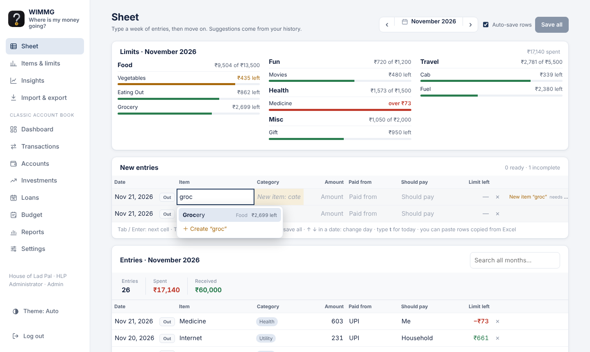
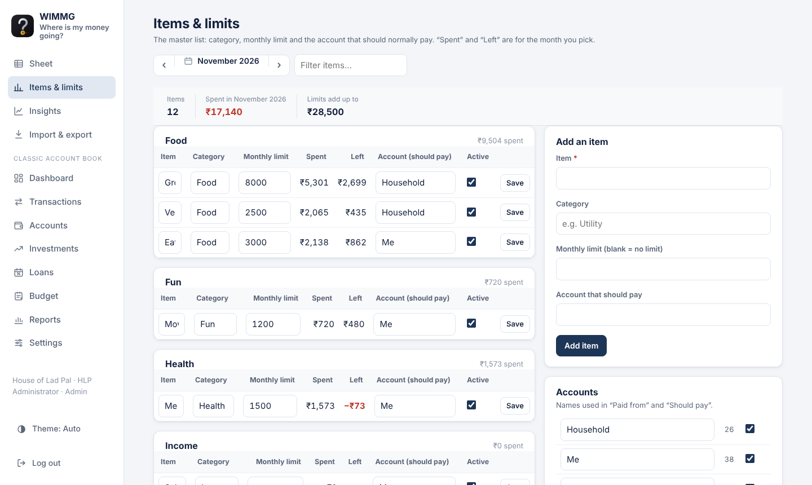
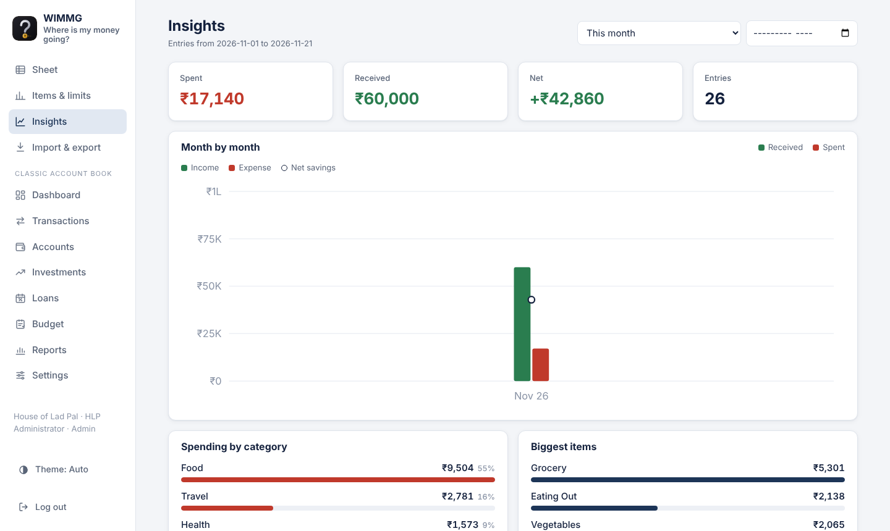
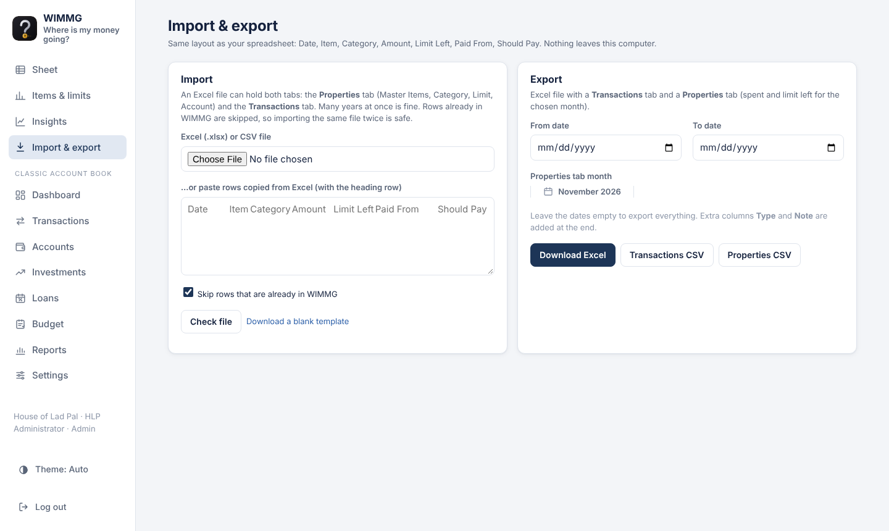
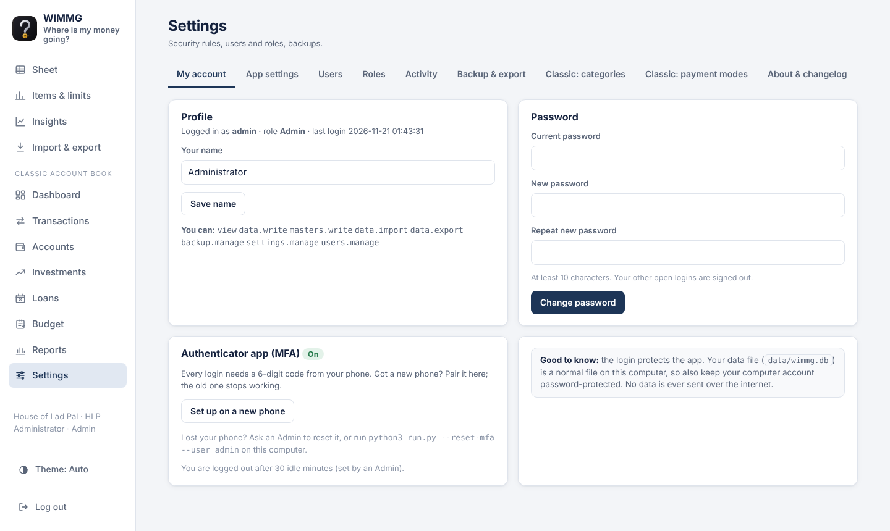
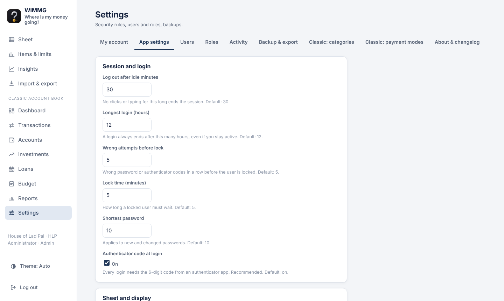
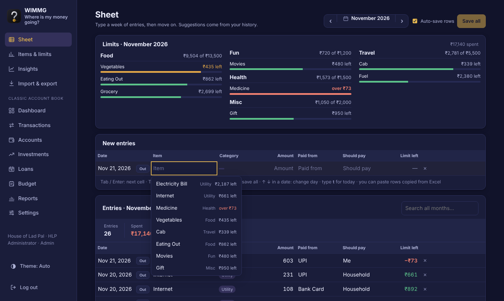

<p align="center"></p>

# WIMMG - Where Is My Money Going?

**A private, fully offline personal expense tracker with a spreadsheet-style entry screen.** Type a week of
expenses and income in one go, see your category limits shrink as you type, record who paid and who should pay,
and move your data in and out as Excel/CSV. It runs on your own computer; nothing is ever sent anywhere.

*By Sarbajit Pal, House of Lad Pal (HLP).*



## Quick start

You need **Python 3.10 or newer** (check: `python3 --version`). Nothing else to install, no internet needed.

```bash
git clone https://github.com/<your-username>/wimmg.git     # or: Code > Download ZIP
cd wimmg
./start.sh                                                 # or: python3 run.py --open
```

1. The terminal prints a **one-time Admin password** (also saved in `data/FIRST_LOGIN.txt`).
2. Open `http://127.0.0.1:5000`, log in as `admin`, choose a new password, and scan the QR code with an
   authenticator app.
3. Open **Import & export** and load your Properties and Transactions, or just start typing in **Sheet**.

Try it with sample data first: `python3 run.py --demo --open` (stored separately in `demo-data/`).

## Features

- **Sheet**: type many entries without any "+ Add" click. Tab/Enter move across; rows save when you leave them.
  Paste rows copied from Excel.
- **Auto-suggest** from your history; picking an item fills category, Should-pay and Paid-from.
- **Paid from / Should pay**, with a netted settle-up in Insights.
- **Limits, live**: Limit Left per row and a Limits panel that updates as you type, including unsaved rows.
- **Excel in your layout**: import/export `Date, Item, Category, Amount, Limit Left, Paid From, Should Pay` plus a
  Properties tab (`Master Items, Category, Limit, Spent, Limit Left, Account`). .xlsx, CSV, TSV or pasted text;
  duplicates are skipped so re-importing is safe.
- **Insights** with charts, drawn locally.
- **Users and roles (RBAC)**: Admin, Editor, Viewer and custom roles; activity log.
- **Configurable security**: session timeout, lockout, password length, 2-step login on/off.
- **Backups**: automatic and on demand, to any folder.
- **Classic account book** (kept from the original project): accounts, credit cards, investments, loans, budget, reports.

| | |
| --- | --- |
|  |  |
|  |  |
|  |  |

## Offline by design

No CDNs, fonts, analytics or email. The page may only talk to the app itself (Content-Security-Policy) and the
server answers only on this computer. See [SECURITY.md](SECURITY.md).

## Your data

Everything is in `data/wimmg.db` (git-ignored). Back up from **Settings > Backup & export**. Updating the app never
touches your data; database changes are applied automatically after an automatic backup.

## Sign-in and recovery

- Forgot a password or lost the authenticator? An Admin can reset it in **Settings > Users**.
- Locked out completely: stop the app and run `python3 run.py --reset-password --user admin`
  (or `--reset-mfa --user admin`).

## Project layout

```
run.py  start.sh        start the app (--open, --port, --demo, --reset-password, --reset-mfa)
backend/                Flask JSON API: api/, services/, migrations/ (applied automatically)
frontend/               HTML, CSS and plain JavaScript modules (no build step)
tests/                  python3 -m unittest discover tests -v
docs/                   DESIGN.md, brand/, screenshots/
vendor/                 Flask bundled as one zip (see vendor/LICENSES.md)
CHANGELOG.md  RELEASE_NOTES.md  DEPLOY_TO_GITHUB.md
```

## Development

```bash
python3 -m unittest discover tests -v
python3 run.py --demo
```

Add a line to `CHANGELOG.md` under *Unreleased* with every change.

## Licence

[MIT](LICENSE). Copyright (c) 2026 Sarbajit Pal, House of Lad Pal (HLP). WIMMG is a new variant derived from an
earlier MIT-licensed project; the MIT licence requires that project's original copyright notice to stay in
`LICENSE`. Bundled libraries keep their own licences ([vendor/LICENSES.md](vendor/LICENSES.md)).
